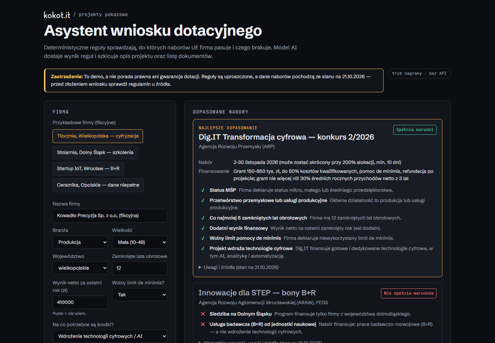
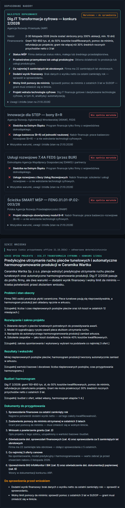
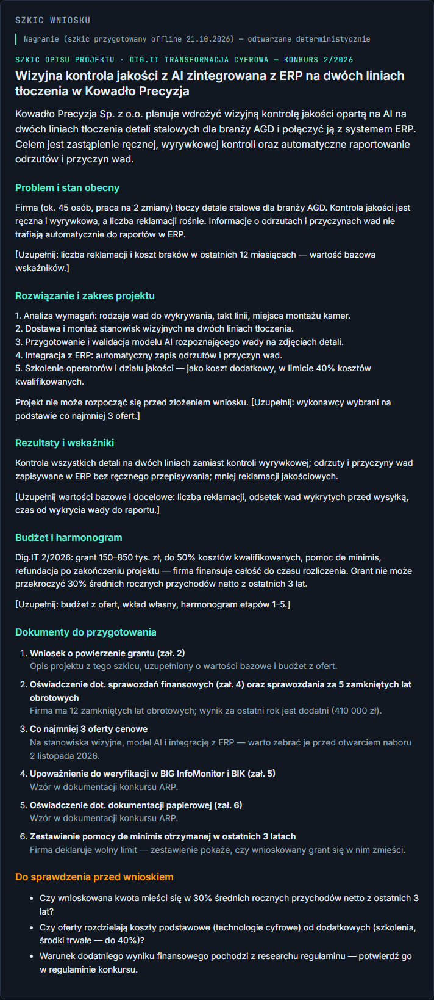
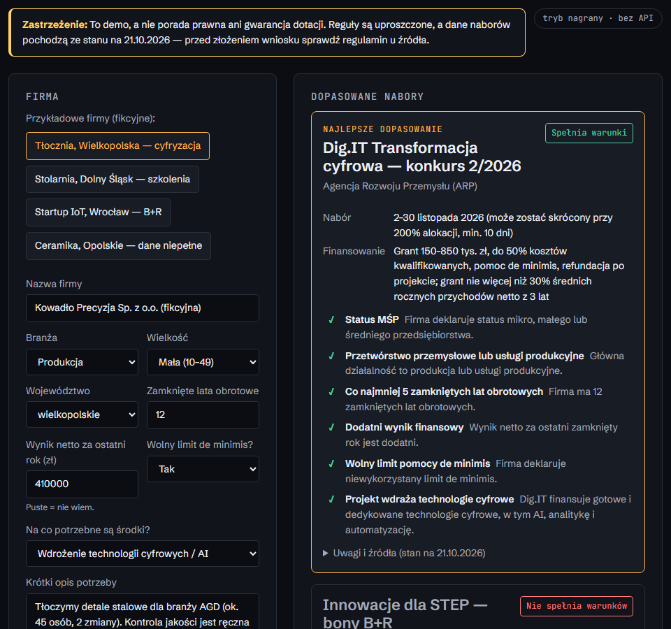
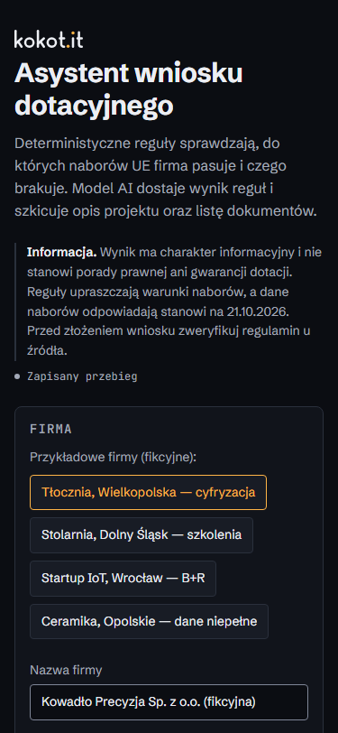

# Grant application assistant

> **Disclaimer.** This is a portfolio demo, **not legal advice and no guarantee of funding**.
> The eligibility rules are simplified and the funding-call data is **as of 21 Oct 2026**
> (each call links to its source). Always check the official rules (_regulamin_) before applying.
> All sample companies are fictional.

**PL:** Demo asystenta wniosku dotacyjnego dla polskich MŚP. Deterministyczne reguły
sprawdzają, do których naborów UE firma pasuje (Dig.IT 2/2026, Innowacje dla STEP, Ścieżka
SMART MŚP, Usługi rozwojowe 7.4A FEDS) i których warunków nie spełnia — np. „brakuje 2 lat
obrotowych”. Model Claude dostaje wynik reguł i pisze szkic opisu projektu oraz listę
dokumentów. To nie jest porada prawna ani gwarancja dotacji; dane naborów ze stanu na
21.10.2026, z linkami do źródeł.

## Problem

Small manufacturers hear about EU grants (e.g. ARP's Dig.IT 2/2026, call 2–30 Nov 2026) but
cannot tell quickly whether they qualify — the hard conditions (SME status, manufacturing
sector, at least 5 closed fiscal years, positive result, de minimis headroom) are spread over
long documents. Then they face a blank project description and a document checklist.

This assistant does both steps, and keeps the part that must be right out of the LLM:

1. **Rules decide eligibility** — plain TypeScript, unit-tested, explainable. Every condition
   comes back as met / unmet / uncertain with a reason.
2. **Claude writes the draft** for the best match — given the rule result, the call data and
   the company description, and never asked to re-judge eligibility.

## Demo

| Recorded run — Dig.IT match                             | Unmet condition ("brakuje 2" years)                           |
| ------------------------------------------------------- | ------------------------------------------------------------- |
|  |  |

| Conditional match with open questions                                    | Draft and documents                     |
| ------------------------------------------------------------------------ | --------------------------------------- |
|  |  |

| Embedded (`?embed=1`)                        | Mobile                                    |
| -------------------------------------------- | ----------------------------------------- |
|  |  |

Screenshots are generated by `npm run screenshots` (headless Chromium against the static
build; run `npm run build` first).

## Running it

Requires Node 22+ (developed on Node 24).

```bash
npm ci
```

### Recorded mode (default — no API key, no server)

```bash
npm run dev        # http://localhost:5173
npm run build      # static site in dist/, works from any sub-path (base: './')
npm run preview
```

The four sample companies replay **recorded, deterministic runs**. If you edit the form, the
rules still run live in the browser; the draft becomes a clearly labelled template, because
an AI-written draft for new input needs the live mode.

### Live mode (real Claude API, local only)

```bash
cp .env.example .env   # then set ANTHROPIC_API_KEY
npm run dev:live       # API on 127.0.0.1:8787, app on http://127.0.0.1:5173
```

`dev:live` starts a small Node server bound to `127.0.0.1` that reads `ANTHROPIC_API_KEY`
from `.env` and calls Claude through the official
[`@anthropic-ai/sdk`](https://www.npmjs.com/package/@anthropic-ai/sdk). Vite proxies `/api`
to it. **The key never reaches the browser**: it is not `VITE_`-prefixed, the client bundle
contains no SDK, and the server recomputes the rules itself instead of trusting the browser.

- Model: `claude-opus-5-5`, effort `medium`, structured output validated against a Zod
  schema (`client.beta.messages.parse` + `betaZodOutputFormat`).
- Server-side refusal fallback is on (`fallbacks: "default"`, beta
  `server-side-fallback-2026-07-01`); a remaining refusal or a truncated answer becomes a
  clear error instead of a half-parsed draft.

### Recording new runs

```bash
npm run record                       # all sample companies
npm run record -- kowadlo-precyzja   # one company
```

`record` runs the live pipeline for the fixtures in `src/fixtures/companies.ts` and overwrites
`src/recordings/<id>.json` with `source: "api"`, the model id and the date. Review the diff
and commit. Each recording stores a hash of its input **and of the rule result**; the test
suite fails if a rule, call or fixture change makes a recording stale, so an outdated draft
can never be replayed silently.

> The recordings committed today are marked `source: "prepared"` with `model: null`: they
> were written offline (no API key was available when the demo was built) in the exact shape
> the live mode returns and under the same rules as the live prompt — only facts from the
> input and the call data, unknowns left as `[…]` placeholders. The UI labels them as
> prepared. Run `npm run record` with a key to replace them with captured runs.

### Embedding (kokot.it case study)

```html
<iframe
  src="https://<host>/grant-assistant/?embed=1"
  title="Asystent wniosku dotacyjnego — demo"
  style="width: 100%; border: 0; min-height: 900px"
  loading="lazy"
></iframe>
<script>
  // Optional auto-height: the demo posts its height on every resize.
  addEventListener('message', (e) => {
    if (e.origin !== 'https://<host>') return;
    if (e.data?.type === 'grant-assistant:height') {
      document.querySelector('iframe[title^="Asystent"]').style.height = `${e.data.height}px`;
    }
  });
</script>
```

`?embed=1` hides the page header and footer; the disclaimer and the mode badge stay visible.

### Quality gates

```bash
npm run lint        # ESLint (typescript-eslint strict) + Prettier check
npm run typecheck   # tsc strict, browser and Node configs
npm test            # Vitest
npm run build
```

CI (`.github/workflows/ci.yml`) runs the same steps with SHA-pinned actions.

## Architecture

```
src/
  data/calls.ts            funding calls: facts, documents, sources, "as of" date
  domain/rules.ts          deterministic eligibility rules + ranking (no LLM)
  domain/hash.ts           canonical JSON + FNV-1a: identity of a run
  domain/playback.ts       deterministic reveal timeline for recorded drafts
  domain/template-draft.ts fallback draft for edited input in recorded mode
  domain/draft-schema.ts   Zod schema of a draft (server and tests only)
  fixtures/companies.ts    four fictional sample companies
  recordings/*.json        recorded runs, replayed by input hash
  ui/                      vanilla TS + DOM, no framework; text set via text nodes only
  styles/tokens.css        ALL colours, fonts and spacing — swap for the brand
server/
  app.ts                   127.0.0.1 HTTP API: validate → rules → generate
  llm.ts                   the only module that calls Claude
  prompt.ts                fixed system prompt + per-request JSON payload
scripts/                   dev-live, record, screenshots
```

**Rules.** Each call has a rule function that returns conditions with
`met | unmet | uncertain` and a Polish explanation. A call is `ineligible` if any condition is
unmet, `conditional` if any is uncertain (e.g. net result unknown), otherwise `eligible`.

| Call                                   | Conditions encoded                                                                                                                     |
| -------------------------------------- | -------------------------------------------------------------------------------------------------------------------------------------- |
| Dig.IT 2/2026 (ARP)                    | SME; manufacturing or production services; ≥ 5 closed fiscal years; net result > 0; de minimis headroom; project is digital technology |
| Innowacje dla STEP (ARAW)              | SME; Lower Silesia; need is an R&D service                                                                                             |
| Usługi rozwojowe 7.4A FEDS (DAWG, BUR) | SME; Lower Silesia; need is training / development services                                                                            |
| Ścieżka SMART MŚP (PARP)               | SME; project includes the mandatory R&D module                                                                                         |

**Ranking.** Status (eligible → conditional → ineligible), then fewer open questions, then a
curated order (smaller, simpler instruments first). The best match is the first call that is
not ineligible; no draft is generated when nothing matches.

**Tests.** Rule boundaries (4 vs 5 years; result −1 / 0 / 1 / unknown; every sector and size;
de minimis answers), ranking, hashing (FNV reference vectors), recording freshness and
deterministic replay, prompt contents, WCAG AA contrast of every token pair (computed
from `tokens.css`, so a brand swap that breaks contrast fails the suite), the HTTP API (validation, size limit, hidden error
details, no model call without a match) and the Claude wrapper against a fake client.

## Limitations

- The rules simplify each call: e.g. Dig.IT's cap of 30% of average revenue, eligible cost
  categories and scoring criteria are not computed; "positive result" comes from research
  notes and should be confirmed in the _regulamin_.
- Call data is a snapshot as of 2026-10-21; windows and conditions change.
- Company size is self-declared; the full SME test (headcount, turnover, linked enterprises)
  is not checked.
- The committed recordings are prepared offline, not captured from the API (see above).
- The UI is Polish only.

## Disclaimer

This tool does not provide legal, tax or funding advice and does not guarantee that a grant
will be awarded. Funding-call information is as of 21 October 2026 and may be outdated —
verify it at the linked official sources. Sample companies are fictional.
