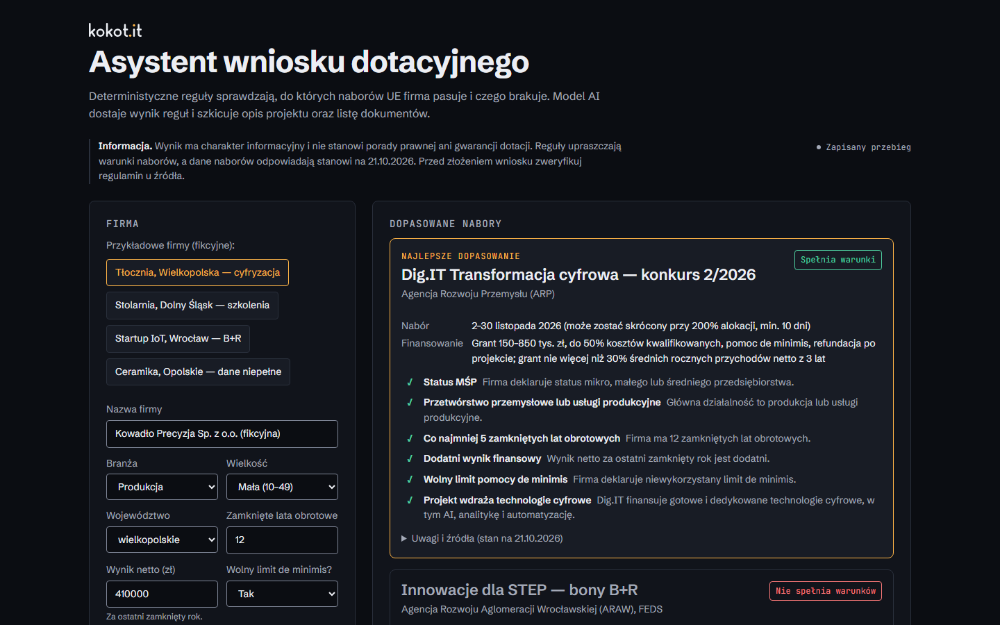
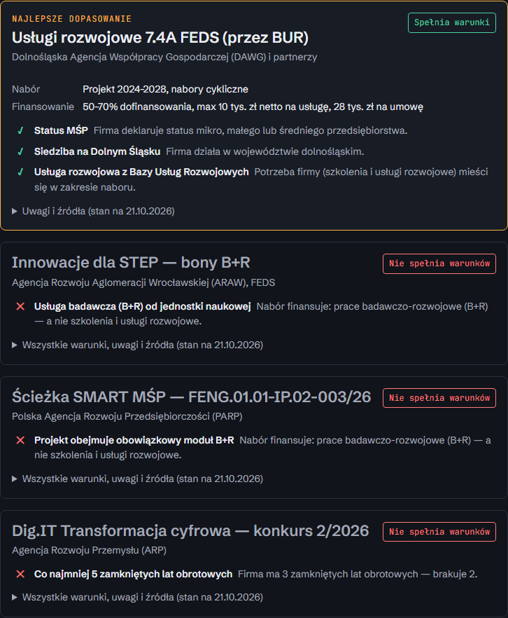
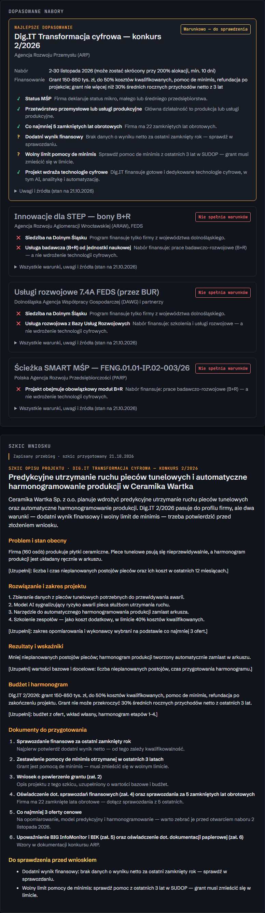
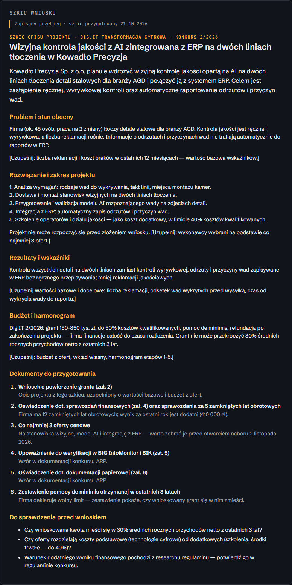
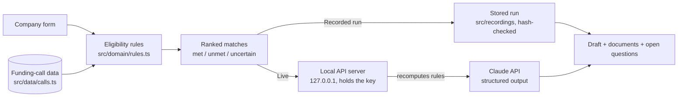

# Grant application assistant

[](https://github.com/Aberratio/grant-assistant/actions/workflows/ci.yml)
[](LICENSE)

Eligibility checks for Polish EU funding calls, with a Claude-drafted project description.
Built for small manufacturers and the advisers who help them: deterministic rules decide
which calls a company qualifies for and exactly which conditions it misses; Claude then
drafts the project description and the document checklist for the best match.



> **Not legal advice.** Results are informational and do not guarantee funding. The rules
> simplify each call, and funding-call data reflects the state as of **21 October 2026**.
> Verify the official regulations (_regulamin_) at the linked sources before applying.

## Key features

- **Explainable eligibility.** Every condition comes back as met / unmet / uncertain with a
  reason, e.g. “brakuje 2 lat obrotowych” (two closed fiscal years short).
- **LLM kept out of the decision.** Rules are plain, unit-tested TypeScript; the model only
  writes the draft and is never asked to re-judge eligibility.
- **Structured drafts.** Claude returns a schema-validated draft: title, summary, sections,
  documents to prepare and open questions, with unknowns left as `[…]` placeholders.
- **Two run modes.** A recorded, deterministic run with no API cost (default for every
  static build) and a live mode that calls the Claude API from a local server.
- **Source-linked call data.** Each call shows its window, funding terms, notes and links to
  the official pages.
- **Embeddable.** `?embed=1` renders minimal chrome for an iframe and reports its height to
  the parent page.
- **Accessible and self-contained.** WCAG AA contrast enforced by tests, keyboard-friendly
  form, self-hosted fonts, no third-party requests.

Funding calls covered: Dig.IT Transformacja cyfrowa 2/2026 (ARP), Innowacje dla STEP (ARAW),
Usługi rozwojowe 7.4A FEDS (DAWG, BUR) and Ścieżka SMART MŚP (PARP).

| Unmet condition                                             | Conditional match with open questions                           |
| ----------------------------------------------------------- | --------------------------------------------------------------- |
|  |  |
| **Draft and documents**                                     | **Mobile**                                                      |
|        |                        |

## Architecture



```
src/
  data/calls.ts            funding calls: facts, documents, sources, "as of" date
  domain/rules.ts          deterministic eligibility rules + ranking (no LLM)
  domain/hash.ts           canonical JSON + FNV-1a: identity of a run
  domain/playback.ts       deterministic reveal timeline for recorded drafts
  domain/template-draft.ts labelled template draft for edited input in recorded mode
  fixtures/companies.ts    four fictional sample companies
  recordings/*.json        recorded runs, replayed by input hash
  ui/                      vanilla TypeScript + DOM; text set via text nodes only
server/
  app.ts                   127.0.0.1 HTTP API: validate → rules → generate
  llm.ts                   the only module that calls Claude
  prompt.ts                fixed system prompt + per-request JSON payload
scripts/                   dev-live, record, screenshots, wording guard
```

Design decisions — ranking, rule edge cases, recordings and the security boundary — are in
[docs/architecture.md](docs/architecture.md).

## Quick start

Requires Node 22+ (developed on Node 24).

```bash
npm ci
npm run dev        # recorded run, no API key: http://localhost:5173
```

Without an API key the four sample companies replay recorded, deterministic runs. If you
edit the form, the rules still run in the browser and the draft becomes a clearly labelled
template.

**Live mode (Claude API):**

```bash
cp .env.example .env   # then set ANTHROPIC_API_KEY
npm run dev:live       # API on 127.0.0.1:8787, app on http://127.0.0.1:5173
```

`dev:live` starts a small Node server bound to `127.0.0.1`; Vite proxies `/api` to it. The
server calls `claude-opus-5-5` through the official
[`@anthropic-ai/sdk`](https://www.npmjs.com/package/@anthropic-ai/sdk) with structured
output validated against a Zod schema; a refusal or a truncated answer becomes a clear
error instead of a half-parsed draft.

**Static build:**

```bash
npm run build      # static site in dist/, works from any sub-path
npm run preview
```

**Recording new runs:**

```bash
npm run record                       # all sample companies
npm run record -- kowadlo-precyzja   # one company
```

`record` runs the live pipeline for the fixtures and overwrites `src/recordings/<id>.json`.
Each recording stores a hash of its input, the rule result and the matched call's data; the
test suite fails if a rule, call or fixture change makes a recording stale.

**Embedding:**

```html
<iframe
  src="https://<host>/grant-assistant/?embed=1"
  title="Asystent wniosku dotacyjnego"
  style="width: 100%; border: 0; min-height: 900px"
  loading="lazy"
></iframe>
<script>
  // Optional auto-height: the app posts its height on every resize.
  addEventListener('message', (e) => {
    if (e.origin !== 'https://<host>') return;
    if (e.data?.type === 'grant-assistant:height') {
      document.querySelector('iframe[title^="Asystent"]').style.height = `${e.data.height}px`;
    }
  });
</script>
```

`?embed=1` hides the page header; the disclaimer, the mode label and the footer with the
source links stay visible.

## Configuration

| Variable                   | Required          | Default | Description                                                      |
| -------------------------- | ----------------- | ------- | ---------------------------------------------------------------- |
| `ANTHROPIC_API_KEY`        | Live mode, record | —       | Claude API key. Read only by the local server, never the client. |
| `GRANT_ASSISTANT_API_PORT` | No                | `8787`  | Port of the local API server used by `dev:live`.                 |

Static builds need no configuration and always use recorded runs.

## Tests and quality

```bash
npm run lint            # ESLint (typescript-eslint strict) + Prettier check
npm run typecheck       # strict tsc, browser and Node configs
npm test                # Vitest: 187 tests
npm run build
npm run check:wording   # scans dist/ and the docs for wording that must not ship
```

The suite covers rule boundaries (4 vs 5 fiscal years; result −1 / 0 / 1 / unknown; every
sector and size; de minimis answers), ranking, hashing (FNV reference vectors), recording
freshness and deterministic replay, prompt contents, WCAG AA contrast of every token pair,
the HTTP API (validation, size limit, hidden error details, no model call without a match),
the Claude wrapper against a fake client, and the full UI flow in a DOM (jsdom). There are
no browser end-to-end tests; screenshots are produced with Playwright by
`npm run screenshots`.

[CI](.github/workflows/ci.yml) runs the same steps on every push and pull request, with
SHA-pinned actions.

## Security

- The Claude API key lives only in the local server process. It is not `VITE_`-prefixed,
  the client bundle contains no SDK, and ESLint forbids importing server code or the SDK
  from browser code.
- The server recomputes the rules itself instead of trusting the browser, validates input,
  caps request size at 16 KiB and binds to `127.0.0.1`.
- Model and user text is rendered as text, never as markup.
- `.env` is git-ignored; `.env.example` documents the variables without values.

## Data

- **Sample companies are fictional.** Names, numbers and plans are invented; any
  resemblance to a real company is accidental.
- **Funding-call data is a snapshot as of 21 October 2026**, checked on the official pages
  linked below and in the app. Windows and conditions change.
- The committed recordings were prepared offline in the exact output shape of the live mode,
  under the same rules as the live prompt, and are labelled as prepared in the app.
  `npm run record` with an API key replaces them with captured runs.

| Call                                          | Operator          | Source                                                                                                                                                                                                                                                          |
| --------------------------------------------- | ----------------- | --------------------------------------------------------------------------------------------------------------------------------------------------------------------------------------------------------------------------------------------------------------- |
| Dig.IT Transformacja cyfrowa — konkurs 2/2026 | ARP               | [digit.arp.pl](https://digit.arp.pl/eventy/nabory/digit-konkurs-22026/), [nowoczesnagospodarka.gov.pl](https://nowoczesnagospodarka.gov.pl/aktualnosci-1-40-mln-na-cyfryzacje-polskich-firm-2-listopada-rusza-drugi-nabor-w-projekcie-dig-it-transformacja-cy/) |
| Innowacje dla STEP — bony B+R                 | ARAW, FEDS        | [wroclaw.pl](https://www.wroclaw.pl/przedsiebiorczy-wroclaw/innowacje-dla-step-granty-dla-firm-dolny-slask)                                                                                                                                                     |
| Usługi rozwojowe 7.4A FEDS (BUR)              | DAWG and partners | [dawg.pl](https://dawg.pl/projekty/dotacje-na-uslugi-rozwojowe-dla-dolnoslskich-firm/)                                                                                                                                                                          |
| Ścieżka SMART MŚP — FENG.01.01-IP.02-003/26   | PARP              | [parp.gov.pl (PDF)](https://www.parp.gov.pl/storage/grants/documents/743/ogloszenie_naboru.pdf)                                                                                                                                                                 |

### Known limitations

- The rules simplify each call: e.g. Dig.IT's cap of 30% of average revenue, eligible cost
  categories and scoring criteria are not computed; the positive-result condition comes from
  the call regulations and should be confirmed there.
- Company size is self-declared; the full SME test (headcount, turnover, linked
  enterprises) is not checked.
- The interface is in Polish.

## Disclaimer

This tool does not provide legal, tax or funding advice and does not guarantee that a grant
will be awarded. Funding-call information reflects the state as of 21 October 2026; verify
it at the linked official sources before applying.

## License

[MIT](LICENSE) © 2026 Joanna Kokot

## Author

Designed and built by [kokot.it](https://kokot.it).
